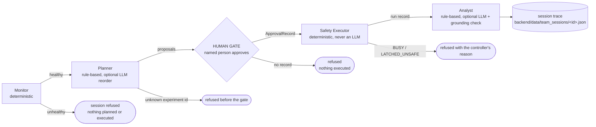

# Multi-agent design

A human-supervised multi-agent copilot for safe chaos engineering on the Eclipse SDV Fleet Management Blueprint.

The agent team is a thin layer over existing, tested code in `backend/multiagent_copilot/agent_team/`. It changes no
behaviour of the safety controller, orchestrator, fault adapters, observer, planner, scoring or findings. It is
coordinated by our own Python pipeline (`pipeline.py`), not by an agent framework. It injects bounded faults, rolls them
back and reports; it fixes nothing.

## The five stages



| Stage | Module | Wraps | What it decides |
|---|---|---|---|
| Monitor | `agents.MonitorAgent` | `RfmsObserver.observe` (N polls, default 6 x 0.5 s), `telemetry.FreshnessTracker`, `EvidenceStore.latest_baseline` | Healthy only if every poll is FRESH, `createdDateTime` advanced, and a baseline with latency exists |
| Planner | `agents.PlannerAgent` | `planner.plan` (always), `ai.ai_plan` (only with `--ai`) | Ranked proposals; the LLM may only return an exact permutation of the allowlisted candidates, otherwise the rule order is kept with a `fallback_reason` |
| Human gate | CLI `mcop team run` / `pipeline.make_approval` | — | An `ApprovalRecord` (non-blank name, time, experiment, what was shown) or nothing |
| Safety Executor | `executor_agent.SafetyExecutorAgent` | `SafetyController.validate` + `ExperimentRunner.run`, exactly as `mcop run` calls them | One run, never retried; all safety rules stay in the controller and runner |
| Analyst | `agents.AnalystAgent` | `scoring.score_run`, `findings.derive_findings` (stored runs including this one), `ai.ai_analyse` (only with `--ai`) | Score, findings citing this run, explanations; AI answers that fail the grounding check are listed as rejected |

## Safety rules of the team layer

- **No skipped approval.** `run_session` executes nothing unless the gate returns an `ApprovalRecord` for an allowlisted
  proposal (and for the requested experiment, when one was requested). `SafetyExecutorAgent.run` raises `TypeError`
  without one. The CLI is non-interactive only when both `--experiment` and `--approved-by` are given; otherwise the
  operator picks a proposal, types a name and types `APPROVE`. There is no `--yes`.
- **Deterministic safety path.** The Safety Executor never uses an LLM and cannot import the AI client. Stop, rollback,
  recovery verification and latching remain in `safety.py` / `orchestrator.py` / `faults.py`, unchanged.
- **Refusals are recorded, not retried.** BUSY and LATCHED_UNSAFE answers become a step with status `refused` and the
  controller's own reason. A stage exception becomes a step with status `error` and ends the session.
- **Advisory AI only.** The LLM (local Ollama, loopback only) sees derived data, can reorder candidates and suggest
  explanations; it has no shell, Docker, credentials or safety-state access.

### Import-guard separation (tests/test_team_import_guard.py)

| Module | May import from the package | Must not import |
|---|---|---|
| `agents.py` | `observation, telemetry, baseline, planner, ai, scoring, findings`, `trace` | `orchestrator, safety, faults, docker_cli, guardrails`, `subprocess`, `os` |
| `executor_agent.py` | `orchestrator, safety, config`, `trace` | `ai`, `agents`, `httpx`, `requests`, any Ollama client |
| `pipeline.py` | `agents, executor_agent, trace` only | anything else from the package |
| `__init__.py` | nothing | — |

The checks are static (AST, the same technique as the existing `ai.py` guard in `tests/test_ai.py`) plus a fresh
interpreter that imports `executor_agent` and asserts `multiagent_copilot.ai` was not loaded, and imports `agents` and
asserts no safety module was loaded.

## Trace fields

Contract: `contracts/team_session.schema.json`. Models: `agent_team/trace.py` (Pydantic v2, `extra="forbid"`, strict).

**TeamSession**: `session_id` (UTC timestamp + 6 hex, like run ids), `started_utc`, `steps`, `approval`
(`ApprovalRecord` or null), `run_id` (or null), `outcome` (`completed` | `aborted` | `refused` | `error`).

**AgentStep**: `agent` (`monitor` | `planner` | `executor` | `analyst`), `role`, `uses_llm` (true only when the local
LLM was consulted; always false for Monitor and Safety Executor), `started_utc`, `ended_utc`, `inputs_summary`,
`output_summary`, `decision`, `evidence_refs`, `status` (`ok` | `fallback` | `refused` | `error`), `fallback_reason`.

**ApprovalRecord**: `approved_by` (non-blank), `approved_at_utc`, `experiment_id`, `shown` (`rank`, `reasons`,
`predicted_symptoms`, `risks`: what the approver saw).

The human gate is recorded as the `approval` object, not as a step; its time sits between the Planner's `ended_utc` and
the Executor's `started_utc`.

## How to read a session file

```bash
cd backend
.venv/Scripts/mcop team sessions                      # newest first: id, outcome, experiment, run, approver
.venv/Scripts/mcop team show 20261102T151952Z-8b5eaa  # one line block per stage, [HUMAN] before [Executor]
```

The committed example `reports/team-sessions/20261102T151952Z-8b5eaa.json` (readable `.txt` beside it, run record
`20261102T151955Z-56a912.json` beside that) reads as follows:

1. `steps[0]` Monitor, `ok`: 6/6 FRESH, `createdDateTime` advanced, baseline present.
2. `steps[1]` Planner, `fallback`, `fallback_reason: "AI disabled"`: the session ran with `--no-ai` because Ollama was
   not running. The rule ranking put `telemetry_stall` third; it was requested with `--experiment`.
3. `approval`: approved by Anshu at 15:19:55.252 UTC for `telemetry_stall`, with the reasons, predicted symptoms and
   risks that were shown.
4. `steps[2]` Executor, `ok`: run `20261102T151955Z-56a912` COMPLETED; stale detected 5.332 s after injection while
   every fault poll returned HTTP 200; rollback verified; recovery verified 2.67 s after rollback. Step time 30.11 s.
5. `steps[3]` Analyst, `fallback` (AI disabled): score 46.1; 8 findings over 46 local run records, 2 cite this run.
6. `outcome: completed`. Whole session 32.8 s.

`status: fallback` is by design: it means a deterministic answer was used instead of the LLM's.

## Limitations

- Agents are coordinated by our own pipeline, not an agent framework; the AI adds little beyond the deterministic layer.
- In the recorded real calls only 1 of 7 analyst explanations passed the evidence check
  (`reports/day2/ai_calls/20261010T233726Z.json`).
- One committed session consulted the LLM (`20261102T162147Z-d11fad`): the Planner's answer was accepted after 180.7 s,
  and the Analyst's call timed out at the configured 240 s and fell back to rule-based text. On this laptop the 7B model
  makes an AI session take minutes (455.0 s in total); an Analyst answer that passed or failed the grounding check in a
  team session has not been recorded yet (the grounding path is covered by unit tests with a mocked Ollama).
- A session is written when it ends. If the process is killed mid-run, the run record and the safety controller's own
  recovery still apply, but that session file is not written.
- The gate's own failure (e.g. an exception while prompting) ends the session with `outcome: error` and no step, because
  the gate is a human, not an agent.
- One session at a time, because the safety controller allows one experiment at a time.

See also: [ARCHITECTURE_OVERVIEW.md](ARCHITECTURE_OVERVIEW.md), [DECISIONS.md](DECISIONS.md) (D-025),
[demo/MULTI_AGENT_DEMO_SCRIPT.md](demo/MULTI_AGENT_DEMO_SCRIPT.md).
